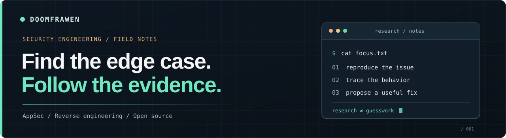

  

  
<strong>Security engineering · Reverse engineering · Building things that work</strong>

  

    <a href="https://honigmann.ca/">Website</a> ·
    <a href="https://github.com/doomfrawen?tab=repositories">Repositories</a> ·
    <a href="https://github.com/pulls?q=is%3Apr+author%3Adoomfrawen">Upstream contributions</a>
  

---

I work in application security, threat modeling, and systems engineering. I enjoy getting past the obvious symptoms: reproducing difficult bugs, figuring out why a boundary fails, and making changes that can actually be tested.

A lot of my public work involves C, NFC hardware, Windows compatibility, protocol analysis, and recovering functionality from devices whose cloud services are gone.

### Selected work

| Security research & upstream patches | Reverse engineering & things I've built |
| --- | --- |
| **[mfoc-hardnested · low-memory crash](https://github.com/nfc-tools/mfoc-hardnested/pull/30)** Traced a `-Z` crash through AVX stack alignment and shared-table lifetime; submitted a proposed fix with debugger evidence and hardware testing. C · GDB · memory safety · [upstream PR](https://github.com/nfc-tools/mfoc-hardnested/pull/30) | **[Sol Local Control](https://github.com/doomfrawen/sol-local-control)** Reverse-engineered LAN communication to control a C by GE Sol lamp without the discontinued cloud service. Includes protocol notes and build instructions. Java · Android · IoT · [protocol notes](https://github.com/doomfrawen/sol-local-control/blob/main/docs/PROTOCOL.md) |
| **[libnfc · Windows and ACR122U](https://github.com/nfc-tools/libnfc/pull/765)** Proposed Windows/MinGW compatibility fixes and reader reconnect handling, with regression tests in Windows CI. C · MSYS2 · PC/SC · [upstream PR](https://github.com/nfc-tools/libnfc/pull/765) | **[Kakitori](https://github.com/doomfrawen/Kakitori)** A kana and Japanese-verb practice app with writing exercises, spaced review, and multilingual support. Runs as an offline web app and Android wrapper. Python · JavaScript · Android · [try the web app](https://doomfrawen.github.io/Kakitori/) |

### More from the workbench

- **[Flux source-controller](https://github.com/fluxcd/source-controller/pull/2231):** proposed a correction to storage deletion test assertions, with a full test run in fork CI.
- **[Other upstream pull requests](https://github.com/pulls?q=is%3Apr+author%3Adoomfrawen):** debugging, portability, regression tests, and fixes across open-source projects.

### What I'm interested in

`Application security` · `Threat modeling` · `Reverse engineering` · `Memory safety` · `Embedded devices` · `CI/CD security` · `Open-source maintenance`

I prefer useful reproductions and code over long lists of technology badges. If something here catches your eye, the linked issues, pull requests, and repositories have the details.

Opinions and experiments here are my own. Upstream pull requests are linked as proposals, not claimed as merged changes.
