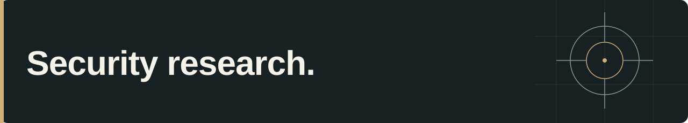

# doomfrawen

I work in security engineering, application security, and threat modeling. This is where I share my public work in reverse engineering, debugging, and security research.

[Website](https://honigmann.ca/) · [Selected work](#selected-work)

## Selected work

### [mfoc-hardnested · Low-memory crash investigation](https://github.com/nfc-tools/mfoc-hardnested/pull/30)

Submitted a proposed patch for the `-Z` low-memory path, with a debugger trace and analysis of stack alignment and shared-table lifetime.

**C · Debugging · Memory management**  
[Read the investigation and proposed patch →](https://github.com/nfc-tools/mfoc-hardnested/pull/30)

### [libnfc · Windows builds and reader reconnect handling](https://github.com/nfc-tools/libnfc/pull/765)

Submitted changes for Windows/MinGW build support and ACR122U PC/SC reader reconnect handling.

**C · Windows / MinGW · NFC**  
[Read the proposed changes →](https://github.com/nfc-tools/libnfc/pull/765)

### [Sol Local Control · Direct LAN device control](https://github.com/doomfrawen/sol-local-control)

An Android app in Java for controlling a C by GE Sol ring lamp over the local network, with reverse-engineered protocol documentation and build instructions.

**Java · Android · Protocol analysis**  
[Source →](https://github.com/doomfrawen/sol-local-control) · [Protocol notes →](https://github.com/doomfrawen/sol-local-control/blob/main/docs/PROTOCOL.md) · [Build guide →](https://github.com/doomfrawen/sol-local-control/blob/main/docs/BUILDING.md)

---

Also building [Kakitori](https://github.com/doomfrawen/Kakitori), an app for practicing kana and Japanese verbs.

More about me: [honigmann.ca](https://honigmann.ca/).

